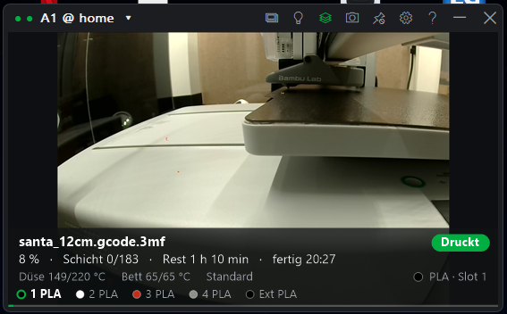

# BambuWatch

Kleines Windows-Tool, das das Live-Bild deines Bambu-Lab-Druckers in einem kompakten, frei skalierbaren Fenster zeigt, mit dem Druckstatus als Overlay darüber. Im Heimnetz direkt vom Drucker, unterwegs über Home Assistant oder die Bambu-Cloud.

**Aktuelle Version:** 2.0 · [Download v2.0](https://cappy0815.github.io/downloads/BambuWatch_v2.0.exe) · Projektseite: [cappy0815.github.io](https://cappy0815.github.io/#bambuwatch)

## Funktionen

- Live-Bild im kleinen Fenster ohne Windows-Rahmen: frei skalierbar, Seitenverhältnis bleibt, Position und Größe werden gemerkt
- Status-Overlay kompakt oder ausführlich: Fortschritt, Restzeit, Fertig-Uhrzeit, Schicht, Temperaturen, Tempo, aktives Filament mit Farbe und alle AMS-Slots
- Mehrere Drucker in einem Fenster, Wechsel per Klick auf den Namen oben links; Verbindungswege pro Drucker einstellbar
- Druckobjekt statt Kamerabild: kommt kein Bild, zeigt BambuWatch das Vorschaubild des Auftrags (aus Home Assistant oder der Bambu-Cloud), per Knopf auch von Hand umschaltbar
- Meldungsfenster mit Bild bei Druckende, Pause und Abbruch, optional mit Ton
- Fortschrittsbalken im Taskleisten-Symbol (grün druckt, gelb pausiert, rot abgebrochen)
- Druckerlicht an/aus, Snapshot des Originalbilds, immer im Vordergrund, Minimieren in den Infobereich
- Pause, solange Bambu Studio läuft: BambuWatch trennt dann alle Verbindungen und verbindet sich danach selbst wieder

## Drucker

| Drucker | Kamerabild | Status im Heimnetz |
|---|---|---|
| A1, A1 mini, P1P, P1S | Einzelbilder direkt vom Drucker | direkt |
| H2D, X1, P2S | Videostream über ffmpeg | mit „LAN Only“ + Developer Mode am Drucker, sonst über Cloud oder Home Assistant |

Am Drucker muss **„LAN Mode Liveview“** eingeschaltet sein, sonst gibt es kein Kamerabild (die Bezeichnung ist je nach Firmware und Sprache leicht anders).

Getestet mit einem A1 (Heimnetz und Home Assistant) und einem H2D (Heimnetz). Die übrigen Modelle nutzen dieselben Schnittstellen, sind aber nicht selbst getestet.

## Verbindungswege

BambuWatch wählt pro Drucker automatisch: **Heimnetz → Home Assistant → Bambu-Cloud**. Oben links steht, woher Bild und Status gerade kommen. Fest einstellen lässt es sich in den Einstellungen unter **Drucker**.

| Weg | Was du brauchst | Liefert |
|---|---|---|
| **Heimnetz** | IP-Adresse, Access Code, Seriennummer | Bild und Status |
| **Home Assistant** | Integration [ha-bambulab](https://github.com/greghesp/ha-bambulab), Adresse(n) von Home Assistant, langlebiges Zugangstoken | Bild, Status, Druckobjekt, Licht – auch unterwegs |
| **Bambu-Cloud** | Anmeldung mit dem Bambu-Konto (E-Mail-Code, Authenticator-App oder Token aus dem Browser) | Status und Druckobjekt, **kein** Kamerabild |

Am einfachsten: **Einstellungen › Konten & Dienste › Bambu-Konto › Anmelden**. Alle Drucker des Kontos werden übernommen, die IP kommt aus dem ersten Status. Ohne Konto: unter **Drucker** IP, Access Code und Seriennummer eintragen und **Verbindung testen**.

Mit Home Assistant findet BambuWatch Kamera, Titelbild und Licht des Druckers selbst über die Seriennummer. Für unterwegs eine zweite Adresse eintragen, unter der Home Assistant von außen erreichbar ist.

### ffmpeg für H2D, X1 und P2S

Diese Drucker senden das Bild als verschlüsselten Videostream. Dafür braucht BambuWatch **ffmpeg** (z. B. ein Windows-Build von [ffmpeg.org](https://ffmpeg.org/download.html)): ZIP entpacken und den Pfad zur `ffmpeg.exe` unter **Konten & Dienste** eintragen. Installieren oder starten muss man ffmpeg nicht.

## Bedienung

| Taste | Funktion |
|---|---|
| `S` | Snapshot (Originalbild ohne Overlay) |
| `O` | Overlay umschalten: aus / kompakt / ausführlich |
| `L` | Druckerlicht an/aus |
| `T` | immer im Vordergrund |
| `1` `2` `3` | Fenstergröße klein / mittel / groß |
| `F1` / `F2` | Hilfe / Einstellungen |
| `F5` | neu verbinden |

Verschieben an der Leiste oder direkt am Bild, Größe am Rand. Rechtsklick aufs Bild öffnet das Menü mit allen Funktionen. Die beiden Punkte oben links zeigen Kamera und Status: grün läuft, gelb verbindet, rot Fehler, grau aus – Maus drauf zeigt Details.

## Installation

Windows 10/11: EXE starten, keine Installation nötig. Eine einzige Datei, ohne Zusatzdateien oder PowerShell-Helfer. Das Programm ist nicht signiert, daher zeigt Windows beim ersten Start „Der Computer wurde durch Windows geschützt“ → *Weitere Informationen* → *Trotzdem ausführen*.

Die Einstellungen liegen in `BambuWatch.ini` neben der EXE (ist der Ordner schreibgeschützt, unter `%APPDATA%\BambuWatch`), Snapshots unter `Dokumente\BambuWatch`.

**Von 1.x umsteigen:** Die 1.x beenden, `BambuWatch_v2.0.exe` in denselben Ordner legen und starten. Version 2.0 liest dieselbe `BambuWatch.ini` – alle Drucker, Zugangsdaten und Einstellungen sind sofort da. Laufen beide gleichzeitig, meldet sich 2.0 und bittet, die alte Version zu beenden.

## Selbst kompilieren

Seit 2.0 ist BambuWatch in **Go** geschrieben, nur mit der Standardbibliothek (Fenster, Grafik und Netzwerk direkt über die Windows-API). Der Quellcode liegt in [`src/`](src).

1. [Go](https://go.dev/dl/) 1.24 oder neuer und [Python 3](https://www.python.org/downloads/) installieren
2. Im Ordner `src` Icon, Versionsinfo und Manifest erzeugen:
   `python mkres.py 2.0.0.0 BambuWatch.ico`
3. Bauen:
   `go build -trimpath -ldflags "-H windowsgui -s -w" -o BambuWatch_v2.0.exe .`

Unter Linux oder macOS geht es genauso mit vorangestelltem `GOOS=windows GOARCH=amd64`. `go test ./...` prüft Einstellungen, Statusauswertung und Anmeldung ohne echten Drucker.

Die alte AutoIt-Version 1.7 (mit PowerShell-Helfer) liegt zum Nachschlagen in [`legacy/`](legacy).

## Sicherheit und Datenschutz

- Das Passwort des Bambu-Kontos wird nie gespeichert. Access Codes, Bambu- und Home-Assistant-Token liegen mit Windows (DPAPI) verschlüsselt in der INI und sind nur mit deinem Windows-Konto lesbar.
- BambuWatch spricht nur mit deinen Druckern, deinem Home Assistant und – falls angemeldet – der Bambu-Cloud.
- Drucker-Ports bitte nicht per Portweiterleitung ins Internet freigeben. Für unterwegs ist der Weg über Home Assistant da.

## Hinweis

Inoffizielles, privates Tool – keine Verbindung zu Bambu Lab. Kamera und Status nutzen die von der Community dokumentierte LAN-Schnittstelle, die Bambu Lab nicht offiziell unterstützt; ein Firmware-Update kann sie ändern. Ohne Gewähr, kein Support.

Änderungen: [CHANGELOG.md](CHANGELOG.md)

Gebaut von Justus Jonas & MCHLNWK · [cappy0815.github.io](https://cappy0815.github.io)
